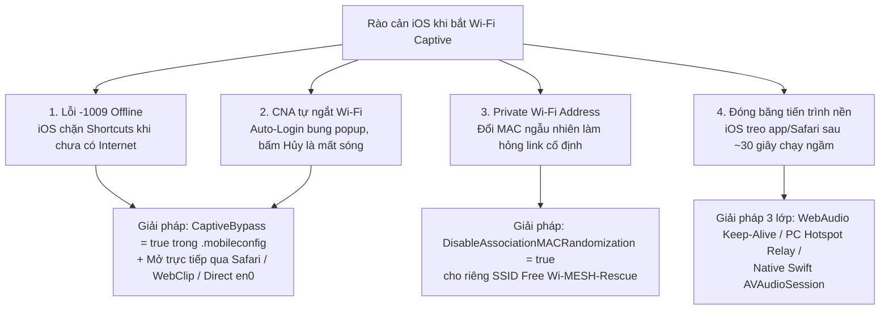

# 📱 Kế Hoạch Kiến Trúc Toàn Diện: Đưa Wi-Fi Rescue Auto-Login Lên iPhone (iOS)

> **Mục tiêu**: Chuyển hóa toàn bộ các tính năng của hệ thống **Wi-Fi Rescue Auto-Login V2.4** từ Windows PC lên iPhone (iOS), khắc phục triệt để các rào cản Sandbox của Apple (`-1009 The Internet connection appears to be offline`, Captive Network Assistant tự ngắt Wi-Fi, Private Wi-Fi Address đổi MAC ngẫu nhiên, giới hạn chạy nền).

---

## 1. Bảng Ánh Xạ Kiến Trúc 1-1 (Windows PC ➔ iPhone iOS)

| Module Trên Windows PC | Vai Trò Cốt Lõi | Kiến Trúc Tương Ứng Trên iPhone (iOS) | File Triển Khai |
| :--- | :--- | :--- | :--- |
| `src/config.js` & `install-startup.ps1` | Cấu hình SSID (`Free Wi-MESH-Rescue`), cố định MAC, ưu tiên kết nối | **Apple Configuration Profile (`.mobileconfig`)**: Payload `com.apple.wifi.managed` bật `AutoJoin`, **`CaptiveBypass = true`**, **`DisableAssociationMACRandomization = true`** | `ios/profile-generator.js` |
| `src/wifi.js` (`directTrialLogin`) | Gửi HTTP GET siêu tốc 0.2s tới `http://186.186.0.1/login?username=T-${macEsc}` | **WebClip 1-Chạm** trên Màn hình chính + **Scriptable** + **Shortcuts V2** dùng MAC cố định | `ios/profile-generator.js`, `ios/scriptable/WiFiRescue.js` |
| `src/portal.js` (Dual-Engine) | Giải Captive Portal + tự động vượt trang trắng & quảng cáo | **Same-Origin Bookmarklet** chạy trực tiếp trong `http://186.186.0.1/status` gọi thẳng `fetch('/login?username=T-' + macEsc)` | `ios/bookmarklet/dashboard-inject.js` |
| `src/dashboard.js` (`xem-thoi-gian.bat`) | Bảng đồng hồ đếm ngược 15 phút theo từng giây & thanh tiến trình | **iOS Dark Mode WebApp (PWA)** + **Safari Same-Origin Dashboard** + **Scriptable Home Widget** | `ios/webapp/index.html`, `ios/scriptable/WiFiRescue.js` |
| `src/index.js` (`runDaemon`) | Vòng lặp nền tự động gia hạn trước khi hết 15 phút (khi còn $\le 30\text{s}$) | **3 Lớp Thực Thi Nền**: 1. **Silent WebAudio Keep-Alive** (Safari PWA/Bookmarklet) 2. **PC Mobile Hotspot Relay** (`src/hotspot.js`) 3. **Native SwiftUI App** (`AVAudioSession` + `en0`) | `src/hotspot.js`, `ios/native-swift/WiFiRescueApp.swift` |
| `scripts/start.ps1` | Khởi chạy và cài đặt nhanh 1-click trên máy | **Server Cài Đặt Qua Mã QR (`src/mobile-server.js`)**: Quét bảng ARP tự động phát hiện MAC iPhone + tải `.mobileconfig` động theo máy | `src/mobile-server.js`, `cai-dat-iphone.bat` |

---

## 2. Phân Tích Rào Cản iOS & Giải Pháp Kỹ Thuật

### Tại sao trước đây Phím tắt (Shortcuts) báo `-1009 Offline`?
1. Khi iPhone mới kết nối vào `Free Wi-MESH-Rescue`, iOS kiểm tra `http://captive.apple.com/hotspot-detect.html`. Do router chưa cấp mạng, iOS đánh dấu đường dẫn mạng là `NWPath.Status.unsatisfied`.
2. Tác vụ `Get contents of URL` trong Shortcuts dùng `NSURLSession` mặc định, bị iOS từ chối ngay từ tầng OS với mã `-1009` trước khi gói tin đi tới `186.186.0.1`.
3. Khi cài **Apple Profile (`.mobileconfig`)** chứa `<key>CaptiveBypass</key><true/>`:
   - iOS bỏ qua cơ chế kiểm duyệt Captive Network Assistant (CNA).
   - Giao diện Wi-Fi (`en0`) được mở thông luồng truy cập cục bộ `186.186.0.1` ngay lập tức, không tự ngắt Wi-Fi và không bung popup quảng cáo ép buộc.
4. Kết hợp `<key>DisableAssociationMACRandomization</key><true/>`: giữ nguyên địa chỉ MAC thật cho SSID `Free Wi-MESH-Rescue`, giúp WebClip 1-chạm và Scriptable luôn chính xác 100%.

---

## 3. Lộ Trình 4 Phương Án Triển Khai Trên iPhone

| Phương Án | Cách Triển Khai | Cần PC Bên Cạnh? | Khả Năng Tự Động & Gia Hạn |
| :--- | :--- | :---: | :--- |
| **1. Mobile Profile + WebClip 1-Chạm** | Chạy `cai-dat-iphone.bat` quét QR (hoặc gửi file `ios/WiFi-Rescue-iOS.mobileconfig`) | Chỉ 1 lần lúc cài | `CaptiveBypass` tự ổn định sóng + icon 1-chạm kích hoạt Internet trong 0.2s |
| **2. Same-Origin Safari Dashboard** | Lưu bookmark `ios/bookmarklet/dashboard-inject.js` chạy trên `186.186.0.1/status` | ❌ Không cần | Đếm ngược từng giây + **Silent Audio Keep-Alive** tự gia hạn trước 45s |
| **3. Scriptable Home Widget** | Cài Scriptable (App Store) + nạp `ios/scriptable/WiFiRescue.js` | ❌ Không cần | Widget Màn hình chính xem thời gian phiên & gia hạn 1 chạm |
| **4. PC Hotspot / Native Swift App** | Bật `bat-phat-wifi-iphone.bat` trên Laptop hoặc build `ios/native-swift/WiFiRescueApp.swift` | Hotspot: Có Swift: Chỉ lúc build | Chạy ngầm tự động 100% 24/7, không cần chạm tay |
